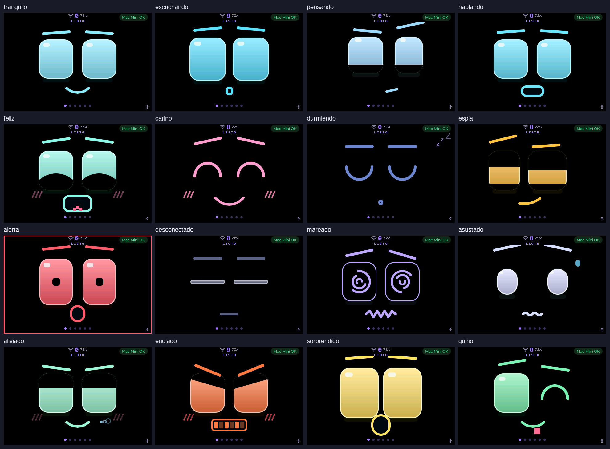

# Jolly, the Mac Mini's guardian

Jolly is the LCDWIKI ES3C40P in landscape (480x320). Its face takes the place of
Muse's avatar and show how the Mac Mini is doing, and four status pages follow
them: Mac Mini, Apps, Red and Seguridad. It reads everything from the
Guardián (`saxo2002AC/warroom-guardian`), a read-only service on the Mini, through
the frozen contract v1. The spec is the guardian plan
(`warroom-guardian/docs/plan-guardian-v1.md`, workstream B) and the v3 landscape
mockup (`warroom-guardian/docs/mockup-v3-horizontal.html`). It's built with
`CONFIG_MUSE_JOLLY`, which only the ES3C40P's overlay turns on.

## Files

| File | What | Tested by |
|---|---|---|
| `../boards/es3c40p_orient.c` | landscape MADCTL and touch remap | `tests/jolly/test_orient.c` |
| `jolly_mood.c` | the mood, first match wins (plan §1.9) | `tests/jolly/test_mood.c` |
| `jolly_alarm.c` | a new crit alarms for a while, a standing one only reminds | `tests/jolly/test_alarm.c` |
| `jolly_face_spec.c` | face v5 as numbers: 16 moods, visemes, springs, blinks, head turn, mouth lines | `tests/jolly/test_face.c` |
| `jolly_eyes.c` | draws face v5 from those numbers, per frame | simulator, `tools/jolly/face_sheet.py` |
| `jolly_glance.c` | strict contract parsers, ETag check, link state (§1.8) | `tests/jolly/test_glance.c` |
| `jolly_client.c` | the poll task, NVS config, console | device, `tools/jolly/fake_guardian.py` |
| `jolly_text.c` | the pages' Spanish strings | `tests/jolly/test_text.c` |
| `jolly_pages.c` | the four status pages and the chips | simulator |
| `../muse_url.c`, `../muse_resolve.c` | `http://host:port` and `.local` names by mDNS | `tests/jolly/test_url.c` |
| `../fonts/jolly_font_*.c` | Montserrat with Latin-1 (`tools/muse/gen_jolly_fonts.sh`) | `test_fonts_cover_spanish` |

`tests/test_jolly_host.py` runs the C tests. The glance test needs
`managed_components/` (after an `idf.py reconfigure`) for cJSON.

## Console (serial only, never BLE)

```
>grd_url=http://Mac-mini-de-acserver.local:3025    the Guardián (or http://IPv4:port)
>grd_key=<key>                                     X-Guardian-Key; never printed or logged
>grd_alarm_s=180                                   how long a new crit alarms, 0..3600 s (security: 10 min)
>grd                                               URL, key length, link, whether a glance arrived, alarm_s
>lcd / >lcd_orient=0|1 / >lcd_madctl=S,X,Y / >lcd_touchlog=1
>tts_url=http://Mac-mini-de-acserver.local:3024 / >tts_key=...
>dns=hatch.metaaivm.com                            resolve a name: @dns {ip | error, ms, servers, ours, forgets}
>time                                              @time {synced, sntp, utc, local, last_sync_s}
>dns_servers=1.1.1.1,8.8.8.8                       DNS ahead of the router's (empty: the router's only); NVS
>whyreset                                          the last 4 setup-wipe sources with uptime, kept across resets
```

An empty value clears a setting. A line in the `grd_`, `tts_`, `sdk_token` or
`lcd_` family that no handler took is refused (`@error invalid secret command`)
and never reaches the setup commands' log.

## Security conditions (Diana's review)

- **R14:** the console refuses malformed `grd_`, `tts_`, `sdk_token` and `lcd_`
  lines (`muse_secret.c`). `run_command` never echoes the value of a secret.
  The keys print only as their length, local copies are wiped, and the serial
  line buffer is wiped before it's freed.
- **R15:** `jolly_client.c` keeps redirects off and enforces each endpoint's body
  cap (glance 1536, apps 3072, events 4096, series 2048 bytes) on
  Content-Length and while reading. It requires `application/json`.
  `jolly_glance.c` parses strictly: `v == 1`, typed fields, known enums,
  clamped integers, UTF-8-safe fixed buffers without control characters,
  arrays up to the contract's length, and series exactly 60 or 24 long. An ETag
  is only sent back if it's 1 to 32 bytes of printable ASCII.
- **R16:** no label uses recolour (`test_no_label_recolor`). Server text arrives
  already sanitized by the parsers. An error response is logged as at most
  64 sanitized bytes, at debug level.

## Simulator

```
cmake -S esp32/simulator -B <build> -G Ninja -DMUSE_SIM_JOLLY=ON
MUSE_SIM_BOARD=es3c40p MUSE_SIM_JOLLY_DATA=crit <build>/muse_simulator --headless \
    --scenario <file with tile=1> --screenshot out.ppm
```

Scenario keys: `face=` drives the voice moods, `jolly=ok|crit|spy|quiet|down|none`
sets the stub's data (crit then ok gives feliz), `pet=1` pats the eyes (cariño),
and `mood=<name>` holds the face on one mood, snapped and still (`mood=auto`
gives it back to the arbiter). `tools/jolly/face_sheet.py <simulator> out.png`
renders all 16 moods as one contact sheet: `esp32/docs/jolly/face-v5-moods.png`.
`MUSE_SIM_BOARD=es3c40p` gives the 480x320 profile. `MUSE_SIM_JOLLY_DATA=ok|crit`
fills the client stub with the fixtures' values. `MUSE_SIM_JOLLY_LINK=down`
gives no link, and `tile=N` in a scenario shows the tileview's column N.

## The face (v5)

Face v5, "robot con expresión", as Andrés approved it:
`warroom-guardian/docs/mockup-cara-v5-fusion.html`. Every number comes from
that mockup's script and CSS and lives in `jolly_face_spec.c`;
`jolly_eyes.c` draws them in the mockup's own 480x320 coordinates (the face's
box starts below the status line, at y 30).



- **Eyes:** 112x128 rounded rects at x 170 and 310, a vertical gradient from
  light to dark, a lighter 3 px rim, a glow (a shadow in the mood's colour), a
  white highlight that moves with the gaze, and a faint shadow below. Lids in
  the background colour: a top one that can slant (a thick `lv_line`, for
  enojado's V), a bottom one, and the curved one of feliz's ^^ (a big circle
  rising from below). Closed eyes are 9 px `lv_arc`s, ^ (cariño, the guiño's
  right eye) or ‿ (durmiendo). Mareado's are hollow with three spinning arcs;
  asustado's are round; alerta's have a core dot.
- **Brows:** 84x9 bars, 2-point `lv_line`s, rotated and raised per mood.
- **Mouths:** smile, big smile, smirk, side, flat, zigzag and wave as
  `lv_line`s (the mockup's SVG paths, sampled); the talking pill; a ring; an
  LED grill whose teeth flicker; the pill's pixel tongue (feliz) and a tongue
  out the corner (guiño).
- **Extras:** "///" blush, hearts (cariño, and a pat), zzz, a sweat drop
  (asustado), sigh puffs (aliviado), the alert's pulsing screen border, and a
  white flash on a landing or a knock themselves (`jolly_imu_flashes()`),
  whatever mood is showing then.

| Mood | Eyes | Mouth | Extras |
|---|---|---|---|
| tranquilo | open, wandering | smile | |
| escuchando | bigger, brows up | small ring | |
| pensando | look up and aside, lower lids | to one side | |
| hablando | open | the pill, by the reply's level | brows follow the level |
| feliz | ^^ (curved lids) | open pill, laughing | tongue, blush |
| cariño | closed ^ | big smile | hearts, blush |
| durmiendo | closed ‿ | tiny breathing ring | zzz |
| espía | narrowed, looking aside | smirk | |
| alerta | tall, core dot | big ring | shakes, border pulses |
| desconectado | slits, grey | flat | |
| mareado | spirals | zigzag | sways |
| asustado | small, round, apart | wave | trembles, sweat drop |
| aliviado | half-lidded | smile | sigh puffs |
| enojado | slanted lids, V brows | LED grill | shudders, red blush |
| sorprendido | tall, brows very high | big ring | |
| guiño | right eye ^ | smile | tongue out |

**Motion.** Each number springs to its target (`v = (v + (t − x) k) · 0.74`,
k 0.11, 0.35 for the talking pill), stepped at the mockup's 60 Hz whatever the
frame rate. A new mood comes in with anticipation: the eyes squash and the
brows dip first (more for sorprendido, alerta and asustado), then overshoot.
Saccades follow each mood's range and rhythm, on their own spring (k 0.22,
0.62). Parallax: eyes 0.8 of the gaze, the highlight 0.3 more, brows 1.0,
mouth 0.5. The head turn widens the eye it turns toward and narrows the other,
16 % at most. Blinks squash and stretch (`sx = 1 + 0.08b`, `sy = 1 − 0.9b`):
single 180 ms, double (20 %) or slow 720 ms (12 %), every 1.8–5.2 s
(3.5–6.5 s pensando), in the moods that blink. Brows and mouth breathe ±2 px
over 3.2 s.

**Talking.** The pill follows the reply's level (`muse_voice` sets it from the
PCM it plays) in five visemes: cerrada under 0.08, chica under 0.32, media
under 0.6, ancha above; a loud syllable rounds into an O about one time in
six.

**Redraw budget.** Only what changed redraws: every setter compares first (a
style set or hiding a hidden object redraws even when nothing changes), each
brow's and line mouth's box is just its own bounds, clear of the eyes and
their glow, and the glow is dropped while an eye moves (it
returns after 300 ms still). The alert's border is four 3 px strips, so its
pulse redraws them and not the screen, in four steps per second; the flash
steps four times in 260 ms. Between saccades and blinks only the breathing
brows and mouth redraw, when they move a whole pixel. Moods that jitter
(alerta, enojado, asustado, mareado) or laugh (feliz) redraw their parts every
frame, as the mockup moves them.

**Arbiter.** Voice, then a pat (cariño), then motion (unless a crit is
alarming), no link (desconectado), an alarming crit (alerta), the level just
worsened (sorprendido, 2 s), a standing crit's hourly glance, a security
warning (espía), a warning just cleared (guiño, 2.4 s), a crit just cleared
(feliz, 4 s), quiet hours (durmiendo), else tranquilo.

**Alarms** (`jolly_alarm.c`, Andrés's rule). Only a *new* crit makes Jolly
alerta: the crit count going up, the level reaching crit, or the security
level reaching crit. It lasts `>grd_alarm_s=` seconds (default 180, 0..3600),
10 min for a security crit, then the face calms down while the chip stays red
("N crítica(s)"). A crit that stands (a backup crit for days) never alarms
again; once an hour it gets a 4 s glance, espía for a security crit,
sorprendido otherwise. A crit already open at boot alarms 30 s at most. The
glance has no alert ids and its headline changes for the same alert ("10
días", "11 días"), so neither counts as new. A tap on the chip opens the page
that explains it: Seguridad for a security warning or crit, else Mac Mini.

**Not from the mockup:** the whole face's tilt (mareado's and the eye
rotation by gaze) and the frame's shaking and tossing, which only show the
sensors in a browser. The background stays the UI's black, so the lids and
core dot are black, and the eye's shadow is a faint reflection in the mood's
colour instead of a darker patch. The eye's rim is drawn after its lids
(`border_post`), so it frames the whole eye as the mockup's does. The gradient has two stops
(`LV_GRADIENT_MAX_STOPS` is 2), light top to dark bottom. Feliz's pill has one
radius (20) where the mockup rounds its bottom more. With Jolly, Muse's caption
moves under the status line, since the face now reaches the page dots, without
its dark band (raised brows reach into it), and stays hidden while it's empty.

## Touch and motion

- **Touch on the face** (`jolly_gesture.c`): a tap pets Jolly. A hold of 350 ms
  without moving more than 40 px is push-to-talk, the BOOT key's path through
  `muse_input_touch_talk()`; Jolly shows escuchando meanwhile. Moving further
  first is a swipe to another page. Once talking, moving never cancels it,
  and it ends only when the finger has been up for 150 ms (a blip doesn't
  end it). While a finger is down the face doesn't hand its scroll to the
  tileview (a 10 px wiggle used to start a page scroll, which ended the
  press and cut the turn); the touch is read every frame while talking, in
  case LVGL let go of it. The log says `face talk: press` and
  `face talk: release (released | press_lost)`, or `face: swipe`. The
  pre-roll is 480 ms on this board, so the 350 ms before the talk starts is
  still recorded.
- **IMU** (`jolly_imu.c`, `jolly_motion.c`): an optional MPU-6050 (GY-521) on the
  I2C header (3V3, GND, SDA IO16, SCL IO15; 0x68 beside the touch controller's
  0x38 and the codec's 0x18), probed at start. Without it nothing changes. With it,
  a 3 KB PSRAM-stack task reads the accelerometer at 100 Hz (gyro off, ±8 g).
  `>imu` prints whether it's there, the last reading in g, and the mood it asks for.

| Motion | Mood | For |
|---|---|---|
| shake (acceleration spread > 450 mg for 400 ms) | sorprendido, then mareado | 1 s, then 3 s |
| freefall (< 0.3 g for 120 ms) | asustado | until the landing, 1.5 s at most |
| landing (> 2 g within 1.5 s of a fall) | aliviado | 2.5 s |
| knock (> 2.5 g for ≤ 30 ms, idle or touched) | enojado | 2 s |
| face-down (gravity on −Z for 2 s) | durmiendo | until it's turned up |

The arbiter puts these after voice and a pat. They win over no link, espía,
feliz and quiet hours, but not over a current crit: security still wins over
play. Face-down assumes the GY-521 lies flat, chip side towards the screen's
front. `>imu` shows which way gravity reads once it's fitted.

## The atajo rápido (parallel mode)

Plan: `WarRoom-Privado/jolly/plan-atajo-rapido.md`, workstream B; Diana's
review `plan-atajo-security-review.md`. Contract v1.1 is Fernando's, copied
as is into `tests/jolly/contract/atajo/` (fixtures, `auth.vectors.json`,
`make_fixtures.py`).

**The atajo in parallel mode gives speed, not privacy.** Every note still
reaches Muse (Meta's servers) whole, as without the atajo; a local answer
only means Jolly speaks first and Muse's reply is never played.

- **Flow (Andrés's D1, parallel):** the note streams to Muse live, exactly as
  without the atajo. On release the recording also goes to the Mini's
  jolly-atajo `/v1/ask` (`jolly_fast_ask.c`, a worker with its own copy). If a
  signed `local` answer comes within `fast_ms` (1500) and Muse hasn't started
  answering, Muse's turn is dropped (`muse_hatch_turn_drop()`: the chat
  stream reset, and Muse's reply refused: by its parent id for good, and in
  the next 2 minutes anything not answering a new turn's own note) and Jolly
  says the answer with muse-voz
  (`speak_local()` in `muse_voice.c`). Otherwise Muse's turn carries on as
  always: forward, error, late, or Muse first. Muse unreachable (the note is
  kept): the atajo alone; a local answer means the note isn't kept.
- **Auth:** the board never sends its key. Requests are signed
  (`X-Jolly-Auth`, HMAC-SHA256 over method, path, timestamp, nonce and the
  body's hash) and answers must carry a valid `X-Jolly-Sig` (HMAC over
  `RESP|nonce|status|sha256(body)`) before they're even parsed
  (`jolly_fast_auth.c`, checked against the contract's vectors). So `.local` (no DHCP reservation, Diana
  C11) only risks the audio reaching an impersonator on the LAN, which
  parallel mode already sends to Muse; it can't make Jolly talk, and learns
  nothing reusable. No synced clock (SNTP), no ask.
- **Diana's C12 (no leaks) doesn't apply:** in parallel mode the audio always
  reaches Muse, by Andrés's choice. D2 (forwarding text) is moot.
- **Console (serial only, the `fast` family is console-only):** `>fast_url=`,
  `>fast_key=` (64 hex, never printed), `>fast=0|1` (**0 by default** until
  Diana's re-check), `>fast_max_s=2..15` (6), `>fast_ms=800..3000` (1500),
  `>fast_log=0|1` (RAM only: what it heard and said), `>fast`.
- **Breaker:** two errors in a row skip the atajo for 5 minutes.
- **Verifying a drop (Diana's acceptance: 20 local questions, no Muse
  reply):** `muse_chat_session: muse turn dropped (local answer), note <id>`
  for each, and `suppressed Muse message <id> (its turn was answered
  locally)` for every reply of Muse's that arrives anyway.
- **Logs:** `fast: local intent=hora ask=640ms stt=512ms`,
  `fast: forward reason=no_match …`, `fast: error <what> …`,
  `fast: first_audio=…ms after release`, `fast: Muse answered first`;
  never the text or the transcript unless `>fast_log=1`.
- **Known case:** a late Muse message arriving while the atajo speaks finds
  muse-voz busy and is shown as text.
- `tools/jolly/fake_atajo.py` stands in for the Mini (scenarios local,
  forward, slow, 500, garbage, big, badsig, refuse; key from a file).

## Decisions

- **Clock** (`jolly_clock.c`): SNTP from pool.ntp.org and
  time.cloudflare.com once Wi-Fi is up (through our DNS servers), re-synced
  every 6 h, in Orlando's time with daylight saving (`EST5EDT,M3.2.0,M11.1.0`).
  Every status bar shows it, 12 h ("3:45 pm"), left of the Wi-Fi icon, and
  "--:--" until synced. `>time` prints the state, UTC and local. Every "hace
  N" still uses the Guardián's own timestamps, and "actualizado hace N s" the
  board's own time since the last 200 or 304.
- **Compact layout:** landscape at 320 px of height takes Muse's compact
  layout (`short_landscape`). The full layout needs about 466 px.
- **One chip:** the status bar is the same on every page, as the plan says.
  The mockup's per-page chips ("Internet OK", "SSH 0 fallos") aren't used.
- **IMU thresholds:** face v5's table proposes 50 Hz, a shake as 4 crossings
  over 1.5 g within 1 s, and face-down after 1 s with the screen dimmed. The
  detector keeps its own (above), which its tests pin down; dimming isn't
  wired. To be settled once an MPU-6050 is on the board.
- **DNS:** the home router's DNS (192.168.0.1) drops queries, so a turn
  failed with `getaddrinfo() returns 202` for Muse's server. `muse_dns.c`
  puts 1.1.1.1 and 8.8.8.8 first (`CONFIG_MUSE_DNS_SERVERS`, set in this
  board's overlay; `>dns_servers=` on the device wins) and the router's last,
  on every lease and every 5 s, since a DHCP renewal sets the router's again
  without an event. The chat connect also resolves its server with two quick
  retries (0.3 s, 1 s) before a turn fails. `.local` names still go by mDNS.
- **Speech:** a reply is spoken from its first whole sentence (20+
  characters) while the rest is still arriving, then sentence by sentence
  (80+ characters a request, 600 at most; `muse_speech_split.c`), so a long
  story is spoken whole up to 8191 bytes (a longer one is logged and cut).
  A message Muse sends after the turn ended (the story after "sure, here's
  one") is played like a reply: queued after anything speaking, quiet hours
  leave it unspoken, a press interrupts it. The chat stays subscribed
  between turns on this board (no 10-minute idle close); what arrives in
  the first 3 s after subscribing is backlog and isn't played.
- **Freezes:** a silent hang (no log, no heartbeat) reboots with backtraces
  instead: `muse_hang.c` watches the UI's frame (20 s) and Link's heartbeat
  (90 s) and prints every task's backtrace before aborting; the overlay also
  turns on the task watchdog with panic (idle tasks on both cores, 15 s) and
  the interrupt watchdog (800 ms). After pulling, delete the build's
  generated `sdkconfig` so the overlay applies.
- **Settings by touch:** on this board the sliders take only their knob (a
  tap on the bar set the mic gain to 0 dB), and Server and Reset pairing
  open on a hold, not a tap.
- **mDNS:** `.local` names are resolved through lwIP's one-shot query
  (`CONFIG_LWIP_DNS_SUPPORT_MDNS_QUERIES`), so there's no mdns component.

## Not in v1

- **Eyes:** the v3 mockup's escuchando waves, pensando dots, hablando EQ bars,
  mood label and radar sweep (face v5 replaced them).
- **Pages:** pulsing status dots, sliding new events, the dashed tx line, and an
  on-screen talk button in landscape. BOOT does push-to-talk.

## Status

Built and host-tested. The simulator renders face v5 (all 16 moods) and all
four pages.
**Not yet on hardware:** face v5's frame rate and redraw cost on the SPI panel,
orientation, touch corners, internal RAM at idle
(plan gate ≥16 KB: read `UI built: free internal` and `ready: ... internal`),
and the live link against the fake or the real Guardián.
